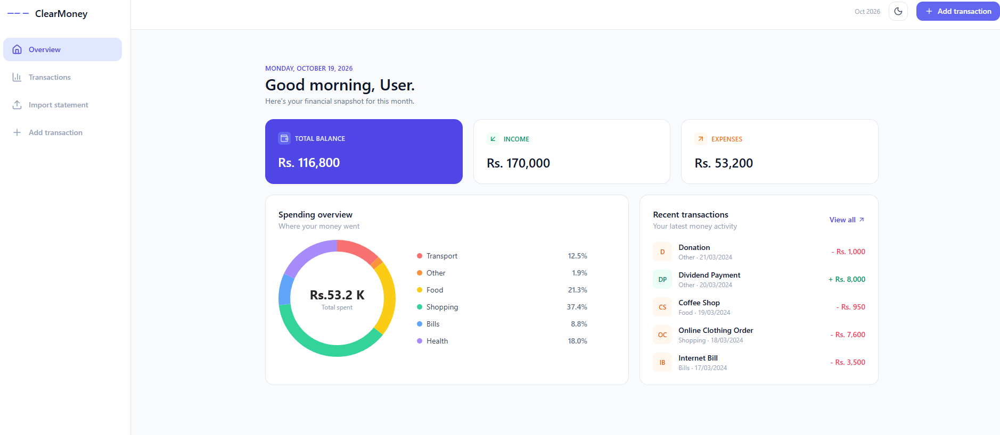
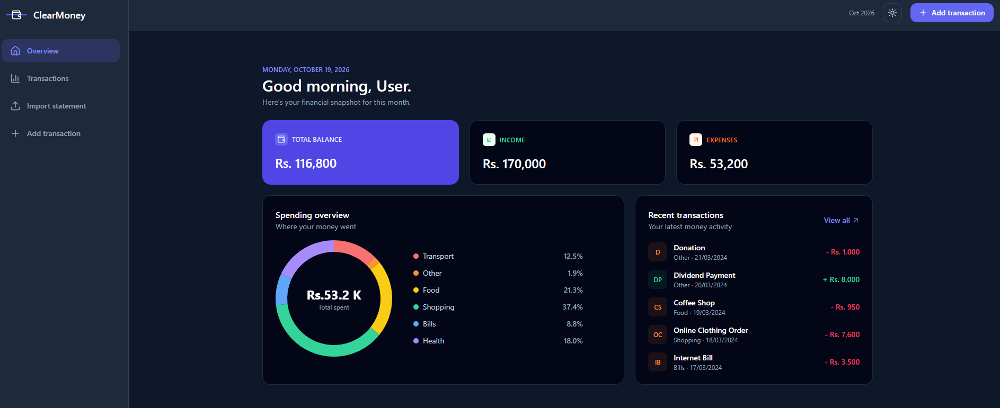
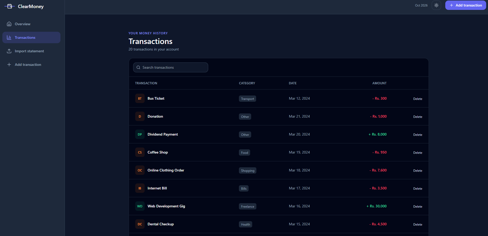
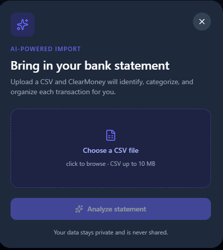
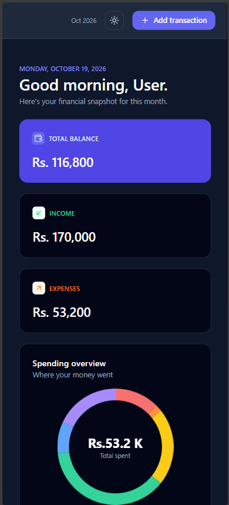

# ClearMoney: Expense Tracker

A full-stack expense tracking application built with the MERN stack. Track income and expenses, see where your money goes with a category breakdown, and import a bank statement CSV that is categorized automatically with AI.

## Live Demo

🔗 https://expense-tracker-mauve-phi-92.vercel.app/

> The backend is hosted on Render's free tier, so the first request after a period of inactivity can take about a minute while the server wakes up.

## Screenshots

| Light | Dark |
| --- | --- |
| ![Dashboard light]  | ![Dashboard dark]  |

| Transactions | Import statement | Mobile |
| --- | --- | --- |
| ![Transactions]  | ![Import] | ![Mobile] |

## Features

- **Dashboard:** total balance, income and expenses, a doughnut chart of spending by category, and the five most recent transactions
- **Add transactions:** income or expense with category, amount, date and an optional description
- **Transaction history:** searchable list with delete
- **AI-powered CSV import:** upload a bank statement in a popup and each transaction is identified and categorized by the Gemini API
- **Dark mode:** one-click light/dark toggle shared across the whole app through React Context
- **Responsive layout:** sidebar on desktop, compact layout on smaller screens, wide tables scroll inside their card

## Tech Stack

| Layer | Technologies |
| --- | --- |
| Frontend | React (Vite), Tailwind CSS, Chart.js, React Router, Lucide icons |
| Backend | Node.js, Express.js, Multer (file upload), Gemini API |
| Database | MongoDB, Mongoose |
| Deployment | Vercel (frontend), Render (backend), MongoDB Atlas |

## How the CSV import works

1. The user picks a `.csv` file in the import popup and clicks **Analyze statement**.
2. The file is sent to the backend as `multipart/form-data` and handled by Multer.
3. The rows are sent to the Gemini API, which returns each transaction with a type (income or expense) and a category.
4. The categorized transactions are saved to MongoDB and the app opens the transactions list.

## Getting Started

### Prerequisites

- Node.js installed
- A MongoDB Atlas account
- A Gemini API key (only needed for the CSV import)

### Installation

1. Clone the repository

   ```bash
   git clone https://github.com/Achch4/Expense_Tracker.git
   cd Expense_Tracker
   ```

2. Install backend dependencies

   ```bash
   cd backend
   npm install
   ```

3. Create a `.env` file inside the `backend` folder

   ```
   PORT=5000
   MONGODB_URI=your_mongodb_connection_string
   GEMINI_API_KEY=your_gemini_api_key
   ```

4. Run the backend server

   ```bash
   npm run dev
   ```

5. Open a new terminal and install frontend dependencies

   ```bash
   cd frontend
   npm install
   ```

6. Create a `.env` file inside the `frontend` folder

   ```
   VITE_API_URL=http://localhost:5000/api
   ```

7. Run the frontend

   ```bash
   npm run dev
   ```

8. Open your browser and go to http://localhost:5173

## Roadmap

- [ ] User accounts with JWT authentication (each user sees only their own transactions)
- [ ] Server-side search, filtering and pagination
- [ ] Duplicate detection when importing the same statement twice
- [ ] Convert the frontend to TypeScript
